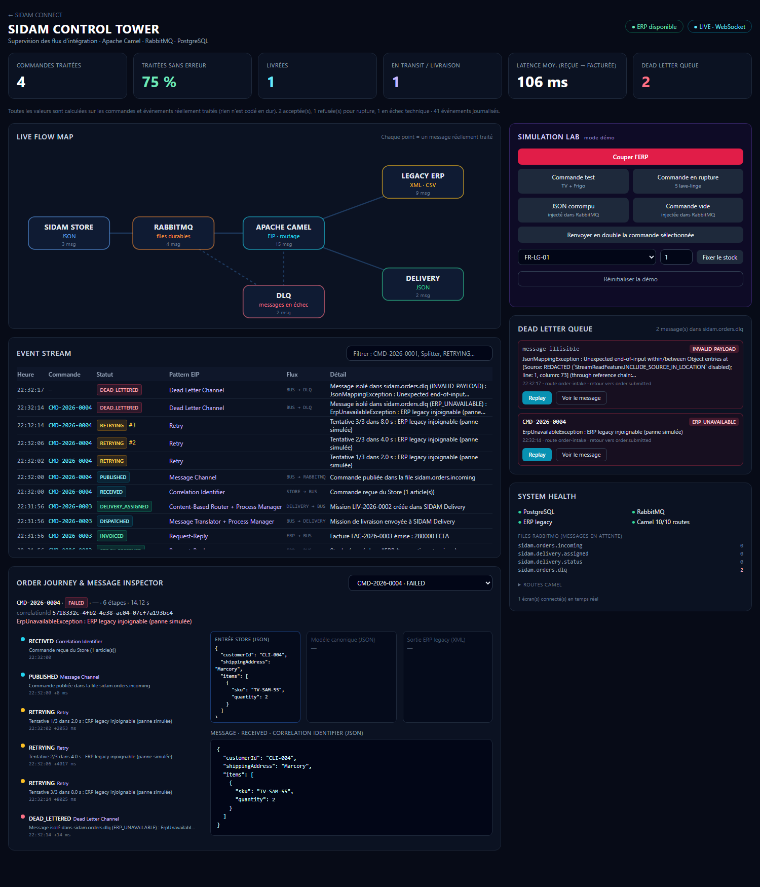

# SIDAM CONNECT — Bus d'intégration

*Three systems. One intelligent ecosystem.*

Bus d'intégration (Apache Camel + Spring Boot) qui relie les trois systèmes de **SIDAM Group**, sans remplacer l'ERP :

| Système | Format | Rôle |
|---|---|---|
| Site e-commerce (**Store**) | JSON | Les clients passent commande |
| **ERP legacy** | XML · CSV | Stock et facturation (système historique, conservé) |
| App des livreurs (**Delivery**) | JSON | Les livreurs reçoivent et confirment les livraisons |

Le bus **transforme** les formats, **route** les messages et **orchestre** le parcours *commande → vérification du stock → facturation → livraison*, en appliquant les patterns d'intégration d'entreprise (EIP).



**Documentation**
- [readme_workflow_TERMINAL.md](readme_workflow_TERMINAL.md) — toute la démo **en ligne de commande**, commande par commande, avec le résultat attendu
- [docs/prd/](docs/prd/README.md) — cahier des charges (contexte, user flows, exigences, architecture, modèle de données, tests)
- [docs/captures/](docs/captures/) — captures des écrans

---

## Sommaire

1. [Stack technique](#1-stack-technique)
2. [Configuration (à faire une seule fois)](#2-configuration-à-faire-une-seule-fois)
3. [Lancer le projet](#3-lancer-le-projet)
4. [Les écrans](#4-les-écrans)
5. [Workflow de démonstration](#5-workflow-de-démonstration)
6. [Le jour de la soutenance](#6-le-jour-de-la-soutenance)
7. [Tests](#7-tests)
8. [Architecture et patterns EIP](#8-architecture-et-patterns-eip)
9. [Structure du dépôt](#9-structure-du-dépôt)
10. [Dépannage rapide](#10-dépannage-rapide)

---

## 1. Stack technique

| Couche | Technologie | Rôle |
|---|---|---|
| Moteur d'intégration | **Java 17 · Spring Boot 3.5 · Apache Camel 4.18 LTS** | Routes et patterns EIP |
| Broker de messages | **RabbitMQ 3** (files durables + Dead Letter Queue) | Tampon asynchrone : aucun message perdu si l'ERP tombe |
| Base de données | **PostgreSQL 15** | ERP simulé (stock, factures), état des commandes, journal d'audit |
| Écrans | **HTML + Tailwind CSS + WebSocket** | Supervision en temps réel, servie par Spring Boot (sans CDN) |
| Infrastructure | **Docker Compose** | Tout l'écosystème en une commande |

---

## 2. Configuration (à faire une seule fois)

### 2.1 Prérequis

| Outil | Obligatoire ? | Remarque |
|---|---|---|
| Windows 10/11 avec **WSL 2** | Oui | Requis par Docker Desktop |
| **Docker Desktop** | Oui | **Seul logiciel nécessaire pour lancer le projet** (pas besoin d'installer Java, Maven, PostgreSQL ou RabbitMQ) |
| **Git** | Oui | Récupérer le projet |
| Navigateur récent (Chrome, Edge, Firefox) | Oui | Pour les écrans |
| 8 Go de RAM | Recommandé | — |
| Java 17 | Non | Seulement pour les tests unitaires hors Docker |

Vérification :

```powershell
docker --version
docker compose version
git --version
```

Chaque commande doit afficher une version. **Docker Desktop doit être démarré** (« Engine running ») avant de continuer.

### 2.2 Récupérer le projet

```powershell
git clone https://github.com/Melv2412/TP_projet_middleware.git
cd TP_projet_middleware
```

Toutes les commandes suivantes se lancent depuis ce dossier.

### 2.3 Ports utilisés

Le projet a besoin que ces ports soient libres sur le PC :

| Port | Service |
|---|---|
| **8080** | Bus d'intégration (API et écrans) |
| **5432** | PostgreSQL |
| **5672** | RabbitMQ |
| **15672** | Console web de RabbitMQ |

Vérifier qu'aucun programme ne les occupe déjà :

```powershell
Get-NetTCPConnection -LocalPort 5432,5672,15672,8080 -State Listen -ErrorAction SilentlyContinue
```

Aucune ligne = c'est bon. Si un port est déjà pris (souvent 5432 par un PostgreSQL installé sur le PC), arrêter ce programme ou changer la partie gauche du port dans `docker-compose.yml` (ex. `"5433:5432"`).

### 2.4 Configuration par défaut

Aucun fichier `.env` à créer : tout est déjà dans `docker-compose.yml`.

| Élément | Valeur |
|---|---|
| PostgreSQL | base `sidam_db`, utilisateur `admin`, mot de passe `password` |
| RabbitMQ | utilisateur `sidam`, mot de passe `sidam` |
| `DEMO_MODE` | `true` : active les boutons de simulation (panne ERP, messages corrompus…) |

Identifiants de démonstration uniquement.

### 2.5 Antivirus

Certains antivirus (Avast notamment) inspectent le HTTPS et peuvent mettre en quarantaine les scripts de test, ou bloquer les téléchargements de Maven lors des tests unitaires. **Ajouter le dossier du projet aux exceptions de l'antivirus.**

### 2.6 Ouvrir l'écran livreur sur un téléphone (optionnel)

1. Le téléphone et le PC doivent être sur **le même Wi-Fi**.
2. Trouver l'adresse IP du PC : `ipconfig`, ligne « Adresse IPv4 » (ex. `192.168.1.25`).
3. Sur le téléphone, ouvrir `http://192.168.1.25:8080/delivery.html`.
4. Si la page ne s'ouvre pas, autoriser le port 8080 dans le pare-feu Windows (PowerShell **administrateur**) :

```powershell
New-NetFirewallRule -DisplayName "SIDAM CONNECT 8080" -Direction Inbound -Protocol TCP -LocalPort 8080 -Action Allow -Profile Private
```

> L'app livreur est une **page web adaptée au mobile** (pas une application native ni une PWA) qui joue le rôle du système externe des livreurs.

---

## 3. Lancer le projet

```powershell
docker compose up -d --build
```

Cette commande construit le bus et démarre 3 conteneurs : `sidam_postgres`, `sidam_rabbitmq`, `sidam_bus`. La base et le stock de démonstration sont créés automatiquement au premier démarrage.

| Lancement | Durée |
|---|---|
| Premier lancement (téléchargements) | 10 à 15 min |
| Lancements suivants | 3 à 5 min (RabbitMQ et le bus démarrent lentement sur un PC portable) |

**Le projet est prêt** quand http://localhost:8080 affiche 4 points verts en bas de page (PostgreSQL, RabbitMQ, ERP, routes Camel). Suivre le démarrage : `docker compose ps` (les 3 conteneurs doivent être `Up`).

| Commande | Effet |
|---|---|
| `docker compose up -d` | Redémarrer sans reconstruire (fonctionne **sans Internet**) |
| `docker compose up -d --build` | Reconstruire après une modification du code |
| `docker compose down` | Arrêter (les données sont conservées) |
| `docker compose down -v` | Arrêter et **effacer toutes les données** |
| `docker logs -f sidam_bus` | Suivre les logs du bus en direct |

---

## 4. Les écrans

| Écran | Adresse | Contenu |
|---|---|---|
| **Accueil** | http://localhost:8080 | Liens vers tous les écrans + état des services |
| **Control Tower** | http://localhost:8080/tower.html | **Écran principal de la démo** : KPI, graphe animé des flux, journal en direct, inspecteur JSON/XML, parcours d'une commande, DLQ + Replay, Simulation Lab |
| **SIDAM Store** | http://localhost:8080/store.html | Boutique : catalogue, panier, suivi de commande en direct |
| **SIDAM Legacy ERP** | http://localhost:8080/erp.html | Style « vieux logiciel » : stock, commandes reçues en XML, factures, import CSV |
| **SIDAM Delivery** | http://localhost:8080/delivery.html | Écran mobile du livreur : missions, prise en charge, confirmation |
| **Console RabbitMQ** | http://localhost:15672 | Files et messages en attente (`sidam` / `sidam`) |

Tous les écrans se mettent à jour **en temps réel** (WebSocket) : chaque changement visible correspond à un message réellement traité par Camel, rien n'est simulé côté navigateur.

---

## 5. Workflow de démonstration

Durée totale : **8 à 10 minutes**.

### Préparation (avant l'arrivée du jury)

1. Lancer le projet (§ 3) et attendre les 4 points verts sur http://localhost:8080.
2. Ouvrir dans le navigateur, un onglet chacun : **Control Tower**, **Store**, **ERP**. Ouvrir **Delivery** sur le téléphone (§ 2.6), ou dans un 4ᵉ onglet en mode mobile (F12 → icône téléphone).
3. Dans la Control Tower, cliquer sur **« Réinitialiser la démo »** : stock d'origine (TV 10, Frigo 6, Lave-linge 2), aucune commande.
4. Garder la **Control Tower** à l'écran principal.

### Acte 1 — Une commande traverse le bus (≈ 2 min)

| Action | Où | Ce qu'on montre |
|---|---|---|
| Ajouter **1 TV + 1 Frigo** au panier, cliquer **Commander** | Store | Une référence `CMD-2026-0001` apparaît |
| Regarder le schéma et l'Event Stream | Control Tower | Les points circulent Store → RabbitMQ → Camel → ERP → Delivery ; une ligne par étape : **Splitter** (une vérification par article), **Aggregator**, **Content-Based Router**, **Message Translator** |
| Regarder « Order Journey & Message Inspector » | Control Tower | Côte à côte : **JSON du Store → modèle canonique → XML de l'ERP**, et un `correlationId` unique sur toute la chaîne |
| Ouvrir l'onglet **Commandes reçues (XML)** puis **Stock** | ERP | La commande est arrivée en XML, facture de **775 000 FCFA**, stock TV 10 → 9 et Frigo 6 → 5 (marqués « réservés ») |

> *« Plus aucun export CSV ni saisie manuelle : la commande du site arrive dans l'ERP, au format de l'ERP, en quelques millisecondes. »*

### Acte 2 — Livraison et synchronisation (≈ 1 min 30)

| Action | Où | Ce qu'on montre |
|---|---|---|
| La mission est déjà là : cliquer **Prendre en charge** | Delivery | Mission créée automatiquement par le bus, avec l'adresse et les articles |
| Cliquer **Confirmer la livraison** | Delivery | — |
| Regarder le suivi de commande | Store | La barre de progression va jusqu'à **Livrée** |
| Onglet **Stock** | ERP | Le stock réservé est sorti, la commande est `DELIVERED` |
| Order Journey | Control Tower | La timeline se termine par **WORKFLOW_COMPLETED** avec la durée réelle |

### Acte 3 — Rupture de stock (≈ 1 min)

| Action | Où | Ce qu'on montre |
|---|---|---|
| Commander **5 Machines à laver** (il en reste 2) | Store (ou bouton « Commande en rupture » du Simulation Lab) | Le Store affiche *« Commande refusée : LAVE-01 : demandé 5, disponible 2 »* |
| Event Stream | Control Tower | Le **Router** envoie la commande vers le canal de rejet |
| Onglets Stock / Factures | ERP | Aucun stock débité, aucune facture, aucune mission livreur |

> *« Le bus empêche exactement le problème de SIDAM : vendre un produit déjà vendu. »*

### Acte 4 — Panne de l'ERP, Retry, DLQ et Replay (≈ 2 min 30)

| Action | Où | Ce qu'on montre |
|---|---|---|
| Cliquer **« Couper l'ERP »** | Control Tower › Simulation Lab | Le nœud ERP passe en rouge ; l'écran ERP affiche une bannière de panne |
| Cliquer **« Commande test »** | Simulation Lab | Lignes `RETRYING` #1, #2, #3 (après 2 s, 4 s, 8 s) |
| Attendre ~15 s | Control Tower | Le message part dans la **Dead Letter Queue** (panneau DLQ, code `ERP_UNAVAILABLE`) : il est conservé, pas perdu |
| *(optionnel)* Ouvrir la console RabbitMQ | http://localhost:15672 › Queues | La file `sidam.orders.dlq` contient 1 message |
| Cliquer **« Rétablir l'ERP »**, puis **Replay** sur le message | Control Tower | La commande est traitée et facturée **une seule fois** |

> *« Une panne de l'ERP ne fait perdre aucune commande : RabbitMQ les garde, le bus réessaie, puis un opérateur les rejoue. »*

### Acte 5 — Données corrompues et doublons (≈ 1 min)

| Action | Où | Ce qu'on montre |
|---|---|---|
| Cliquer **« JSON corrompu »** | Simulation Lab | Le message est isolé **immédiatement** en DLQ (`INVALID_PAYLOAD`), sans tentative inutile, sans effet sur le stock |
| Sélectionner une commande facturée, cliquer **« Renvoyer en double »** | Simulation Lab | `DUPLICATE_IGNORED` (**Idempotent Consumer**) : aucune seconde facture |
| *(optionnel)* Onglet **Import CSV** | ERP | Un CSV au format historique devient une commande et suit le même circuit |

### Conclusion

Montrer les **KPI** en haut de la Control Tower (tous calculés sur les données réelles), puis :

> *« Nous n'avons pas remplacé l'ERP de SIDAM Group. Nous avons donné à ses trois systèmes la capacité de communiquer, de comprendre leurs formats respectifs et de travailler ensemble. Une commande est désormais un processus automatique, traçable et résilient. »*

### Version terminal de la démo

Toute la démo peut être faite sans les écrans : voir **[readme_workflow_TERMINAL.md](readme_workflow_TERMINAL.md)**.

---

## 6. Le jour de la soutenance

| Quand | Quoi |
|---|---|
| **La veille, avec Internet** | `docker compose up -d --build`, puis dérouler une fois toute la démo |
| **Le jour J** | `docker compose up -d` — **sans `--build`** : aucune connexion Internet n'est nécessaire (images déjà sur le PC, Tailwind inclus dans le projet) |
| **5 min avant de passer** | Lancer le projet, attendre les 4 points verts, cliquer sur **« Réinitialiser la démo »** |
| **Ne pas faire** | Lancer les scripts de test juste avant : ils effacent les données de démo |

---

## 7. Tests

### Tests d'intégration (le projet doit tourner)

```powershell
powershell -ExecutionPolicy Bypass -File scripts\test-etape2.ps1              # flux nominal, rupture, validation
powershell -ExecutionPolicy Bypass -File scripts\test-etape3.ps1              # doublons, commandes simultanées
powershell -ExecutionPolicy Bypass -File scripts\test-etape4-resilience.ps1   # panne ERP, retry, DLQ, replay, CSV
powershell -ExecutionPolicy Bypass -File scripts\test-etape5.ps1              # livraison jusqu'à DELIVERED
powershell -ExecutionPolicy Bypass -File scripts\test-etape6.ps1              # écrans, WebSocket, métriques
```

Résultat attendu : `Tous les tests de l'étape N passent.` pour chaque script (107 vérifications au total).

### Tests unitaires (Java 17, sans Docker)

```powershell
cd integration-bus
$env:MAVEN_OPTS = "-Djavax.net.ssl.trustStoreType=Windows-ROOT"   # si un antivirus inspecte le HTTPS
.\mvnw.cmd test
```

Résultat attendu : `BUILD SUCCESS` (traductions JSON/XML, Aggregator, réservation concurrente, journal).

---

## 8. Architecture et patterns EIP

```
                       ┌───────────────────────────────────────────────┐
 SIDAM Store ──JSON──► │ RabbitMQ  sidam.orders.incoming (file durable) │
                       └──────────────────────┬────────────────────────┘
                                              ▼
                ┌──────────────────── APACHE CAMEL ─────────────────────┐
                │ Idempotent Consumer → Message Translator + Enricher   │
                │ → Splitter → Aggregator → Content-Based Router        │
                │      ├─ rupture ──► canal de rejet                     │
                │      └─ OK ──► Translator (XML) ──► ERP legacy         │──► PostgreSQL
                │ Retry ×3 → Dead Letter Channel (sidam.orders.dlq)      │    (erp + bus + journal)
                │ Process Manager livraison ◄──► SIDAM Delivery (JSON)   │
                └───────────────────────────┬───────────────────────────┘
                                            ▼  WebSocket
                                   Control Tower · Store · ERP · Delivery
```

| Pattern EIP | Rôle dans le projet |
|---|---|
| **Message Channel** | Files RabbitMQ durables entre les systèmes |
| **Message Translator** | JSON ⇄ modèle canonique ⇄ XML ; CSV → modèle canonique |
| **Content Enricher** | Ajout des prix et désignations de l'ERP |
| **Splitter / Aggregator** | Vérification du stock article par article, puis verdict global |
| **Content-Based Router** | Stock disponible → ERP ; rupture → rejet ; statut livreur → étape suivante |
| **Idempotent Consumer** | Un message reçu deux fois n'est traité qu'une fois |
| **Retry** | 3 tentatives (2 s, 4 s, 8 s) en cas de panne technique |
| **Dead Letter Channel + Replay** | Messages en échec conservés, rejouables par un opérateur |
| **Process Manager** | Suivi de la livraison dans l'ordre (assignée → en cours → livrée) |
| **Correlation Identifier** | Un `correlationId` commun de la commande à la livraison |

Garantie métier : la réservation du stock se fait en **une seule opération SQL atomique** (`UPDATE … WHERE available >= quantité`), donc deux clients ne peuvent jamais acheter le même dernier article.

---

## 9. Structure du dépôt

```
docker-compose.yml               PostgreSQL + RabbitMQ + bus
readme_workflow_TERMINAL.md      Démo complète en ligne de commande
docs/prd/                        Cahier des charges (12 fichiers)
docs/captures/                   Captures des écrans
integration-bus/                 Application Spring Boot + Camel
  Dockerfile
  src/main/java/com/sidam/connect/
    route/       Routes Camel (EIP)
    api/         API REST (commandes, ERP, livraison, DLQ, supervision, démo)
    order/       Réception, validation et état des commandes
    config/      Configuration RabbitMQ (DLQ) et WebSocket
    translate/   Conversions JSON ⇄ canonique ⇄ XML / CSV
    erp/         Adaptateur ERP legacy (XML, réservation atomique, facture)
    delivery/    App livreur simulée (ne parle au bus que par RabbitMQ)
    dlq/         Dead Letter Queue et Replay
    audit/       Journal d'intégration
    live/        Diffusion WebSocket vers les écrans
    model/       Messages et modèle canonique
  src/main/resources/
    db/migration/  Schémas erp / bus / delivery + données de démo (Flyway)
    static/        Écrans HTML + Tailwind (inclus, sans CDN)
scripts/                         Tests d'intégration PowerShell par étape
```

---

## 10. Dépannage rapide

| Problème | Solution |
|---|---|
| `Cannot connect to the Docker daemon` | Démarrer Docker Desktop |
| `container sidam_rabbitmq is unhealthy` | RabbitMQ a été trop lent : relancer `docker compose up -d` |
| `port is already allocated` | Port occupé : voir § 2.3 |
| Erreur réseau pendant `--build` | Relancer ; sans Internet, utiliser `docker compose up -d` sans `--build` |
| Page blanche / « Bus injoignable » | Le bus démarre encore : attendre, puis `docker logs --tail 50 sidam_bus` |
| Commande bloquée en `FAILED` | Elle est en DLQ : rétablir l'ERP puis **Replay** |
| Un script de test a disparu | Quarantaine de l'antivirus : voir § 2.5 |

Dépannage détaillé : [readme_workflow_TERMINAL.md § 11](readme_workflow_TERMINAL.md#11-dépannage).
