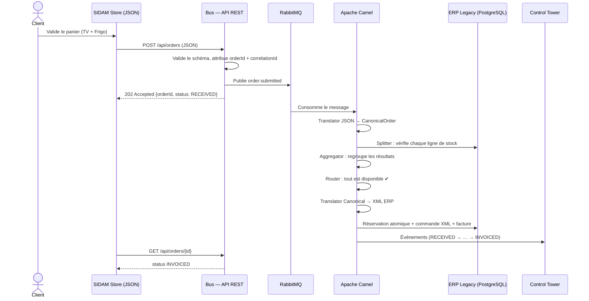
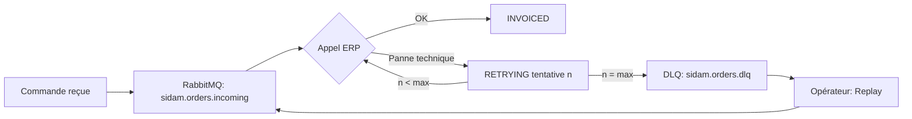
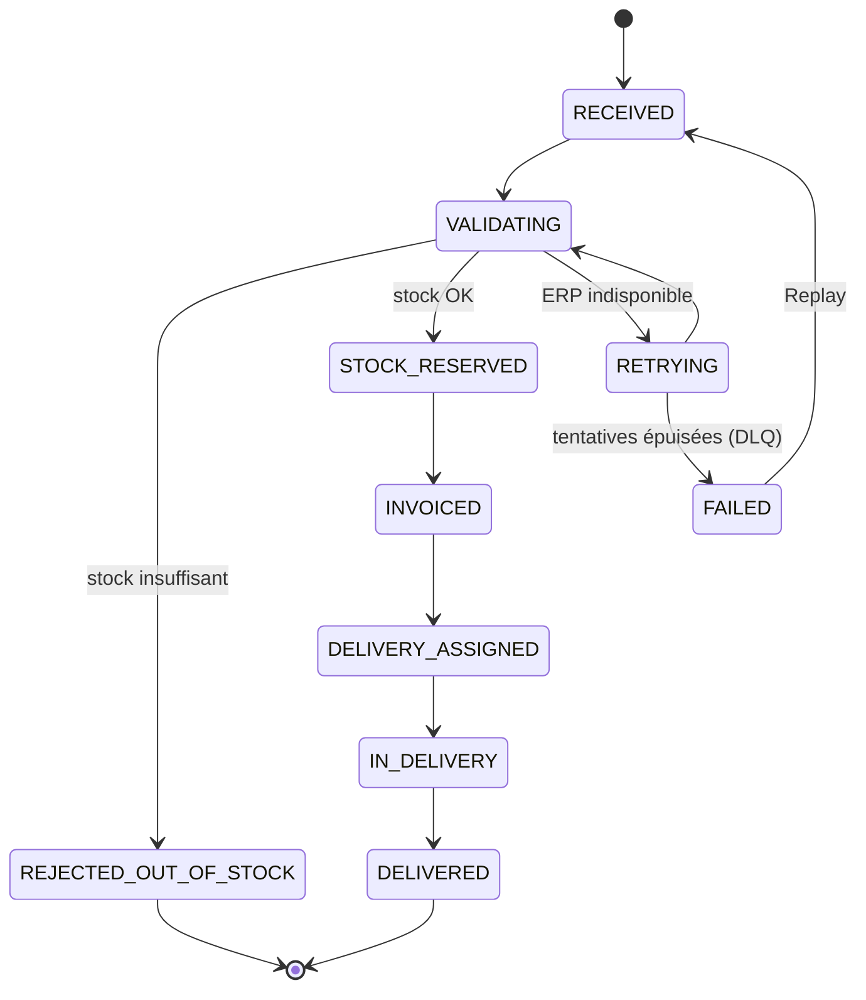

# 03 — User flows

## UF-1 — Commande nominale (stock suffisant)

## UF-2 — Rupture de stock

1. Le client commande 5 machines à laver (stock : 2).
2. Le Splitter vérifie la ligne → `available=2 < requested=5`.
3. L'Aggregator marque la commande « incomplète ».
4. Le Content-Based Router envoie la commande vers la route de rejet.
5. Statut `REJECTED_OUT_OF_STOCK` ; **aucun stock débité, aucune facture, aucune mission**.
6. Le Store affiche le refus et la quantité disponible.

## UF-3 — Panne de l'ERP (résilience)

Règles :
- Un **incident technique** (ERP injoignable) → retry avec délai croissant, puis DLQ.
- Un **refus métier** (stock insuffisant) → pas de retry, rejet direct.
- Au rejeu, la clé d'idempotence garantit **un seul** enregistrement ERP.

## UF-4 — Message corrompu

1. Un message JSON / XML invalide est injecté.
2. La validation échoue → message isolé en DLQ avec motif (`INVALID_PAYLOAD`).
3. Control Tower affiche un voyant rouge ; aucun effet métier.
4. Après correction, l'opérateur peut rejouer le message.

## UF-5 — Livraison

1. Commande `INVOICED` → le bus crée une mission (`DELIVERY_ASSIGNED`) et publie `delivery.assigned`.
2. Le livreur voit la mission sur SIDAM Delivery, la prend en charge (`IN_DELIVERY`).
3. Il confirme la livraison → `POST /api/deliveries/{id}/confirm`.
4. Le bus propage `DELIVERED` vers Store, ERP et Control Tower.

## UF-6 — Import CSV (format historique)

1. Le gestionnaire dépose un CSV (`order_id,sku,quantity,unit_price`).
2. Camel lit le fichier, regroupe les lignes par `order_id`.
3. Translator CSV → CanonicalOrder, puis même parcours que UF-1.

## Cycle de vie d'une commande

