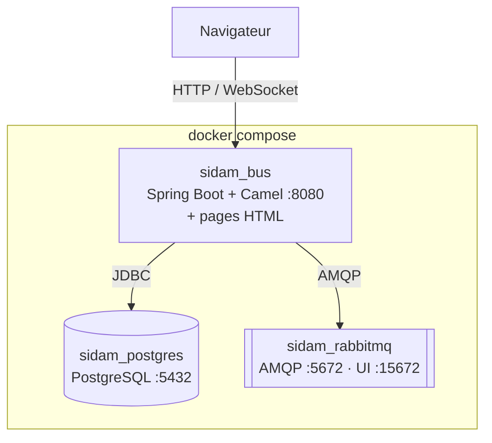

# 06 — Architecture technique

## Stack retenue

| Couche | Technologie | Version | Justification |
|---|---|---|---|
| Langage | Java | 17 (LTS) | Imposé par le dossier d'architecture |
| Framework | Spring Boot | 3.5.x | Version supportée par Camel 4.18 LTS |
| Moteur d'intégration | Apache Camel | 4.18.x (LTS) | Implémentation native des EIP (Splitter, Aggregator, Router, Translator, DLC) |
| Message broker | RabbitMQ | 3-management-alpine | Tampon asynchrone durable, DLQ, console web |
| Base de données | PostgreSQL | 15-alpine | ERP simulé + journal d'audit |
| Migrations | Flyway | (géré par Spring Boot) | Schéma et données de démo reproductibles |
| Accès BDD | Spring JDBC (`JdbcTemplate`) | — | SQL explicite, réservation atomique visible |
| Interfaces | HTML5 + Tailwind CSS 3.4 (fichier local `static/vendor/tailwind.js`) + JavaScript | — | Servies par Spring Boot, aucun build front, fonctionnent sans Internet |
| Temps réel | WebSocket natif (`/ws/events`, Spring WebSocket) | — | Chaque événement journalisé est poussé aux écrans, sans F5 |
| Infrastructure | Docker + Docker Compose | — | Lancement en une commande |

## Conteneurs



## Composants internes du bus

| Package | Rôle |
|---|---|
| `api` | Contrôleurs REST (Store, ERP, Delivery, Tower, démo) |
| `model` | `CanonicalOrder`, `OrderLine`, résultats de stock |
| `route` | Routes Camel (une classe par flux) |
| `erp` | Adaptateur ERP legacy : vérification et réservation de stock, facture |
| `audit` | Journal des événements d'intégration |
| `config` | Configuration RabbitMQ, Camel, WebSocket |

## Flux principal (étape 2)

```
Store ──POST JSON──▶ OrderController ──▶ RabbitMQ (sidam.orders.incoming)
                                              │
                                              ▼
                                   Route "order-intake"
                       JSON → CanonicalOrder (Message Translator)
                                              │
                          split(lignes) ──▶ vérification stock ERP (Splitter)
                                              │
                             aggregate ──▶ verdict global (Aggregator)
                                              │
                               choice() ─ Content-Based Router
                         ┌────────────────────┴────────────────────┐
                    stock OK                               stock insuffisant
                         │                                         │
       Canonical → XML ERP (Translator)                REJECTED_OUT_OF_STOCK
       réservation atomique + facture
                         │
                     INVOICED
```

## Choix structurants

1. **L'ERP n'est pas remplacé** : il est simulé par un schéma PostgreSQL `erp` auquel le bus n'accède que via un **adaptateur** qui parle XML. Le bus ne modifie jamais les tables ERP en dehors de cet adaptateur.
2. **Séparation des schémas** : `erp` (système historique) / `bus` (état et audit du middleware).
3. **Asynchrone** : l'API répond `202 Accepted` immédiatement ; le traitement se fait depuis RabbitMQ. Si le bus redémarre, les messages restent dans la file.
4. **Vérification puis réservation** : le Splitter fait une pré-vérification ligne par ligne (lisible pour la démo) ; la réservation finale est une transaction SQL unique avec `UPDATE … WHERE available >= qty` pour garantir l'absence de survente.
5. **Configuration par variables d'environnement** (`SPRING_DATASOURCE_URL`, `SPRING_RABBITMQ_HOST`, `DEMO_MODE`).

## Ports

| Service | Port | Usage |
|---|---|---|
| Bus (API + pages) | 8080 | http://localhost:8080 |
| PostgreSQL | 5432 | Client SQL (DBeaver, pgAdmin) |
| RabbitMQ AMQP | 5672 | Bus ↔ broker |
| RabbitMQ Management | 15672 | http://localhost:15672 (sidam / sidam) |
