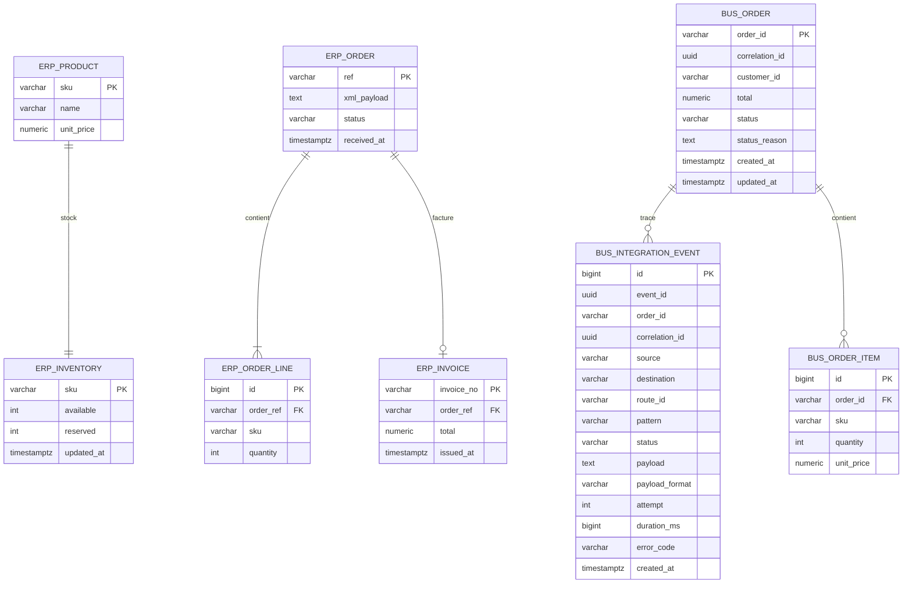

# 07 — Modèle de données

Deux schémas PostgreSQL dans la base `sidam_db` :
- **`erp`** : simulation de l'ERP legacy (le « système historique »).
- **`bus`** : état et audit du middleware.

## Schéma `erp`

| Table | Rôle | Contraintes clés |
|---|---|---|
| `erp.product` | Catalogue | `sku` PK |
| `erp.inventory` | Stock disponible / réservé | `available >= 0` (CHECK) |
| `erp.erp_order` | Commandes reçues par l'ERP, avec le **XML reçu** | `ref` PK → idempotence ERP |
| `erp.erp_order_line` | Lignes de commande ERP | FK `order_ref` |
| `erp.invoice` | Factures | `order_ref` UNIQUE → une facture par commande |

## Schéma `bus`

| Table | Rôle | Contraintes clés |
|---|---|---|
| `bus.orders` | État courant de chaque commande vue par le bus | `order_id` PK, `correlation_id` UNIQUE |
| `bus.order_item` | Lignes telles que reçues | FK `order_id` |
| `bus.integration_event` | Journal d'audit (une ligne par étape) | index sur `order_id`, `correlation_id` |
| `bus.dead_letter` | Index des messages en DLQ (motif, code, payload, date de rejeu) ; le message lui-même reste dans RabbitMQ | `dlq_id` PK |
| `bus.processed_message` | Clés d'idempotence (`ORDER_SUBMITTED:CMD-…`) | `message_key` PK |

## Schéma `delivery` (app livreur simulée)

| Table | Rôle | Contraintes clés |
|---|---|---|
| `delivery.mission` | Missions (`LIV-AAAA-NNNN`), colis JSON, livreur, horodatages | `order_id` UNIQUE → une mission par commande |

`bus.orders.delivery_status` garde le dernier statut de livraison connu du bus (Process Manager).

## Statuts (`bus.orders.status`)

`RECEIVED`, `VALIDATING`, `STOCK_RESERVED`, `INVOICED`, `REJECTED_OUT_OF_STOCK`, `RETRYING`, `FAILED`, `DELIVERY_ASSIGNED`, `IN_DELIVERY`, `DELIVERED`.

## Jeu de données de démonstration

| SKU | Produit | Prix (FCFA) | Stock initial |
|---|---|---:|---:|
| TV-SAM-55 | Téléviseur Samsung 55 pouces | 350 000 | 10 |
| FR-LG-01 | Réfrigérateur LG | 425 000 | 6 |
| LAVE-01 | Machine à laver | 280 000 | 2 |
